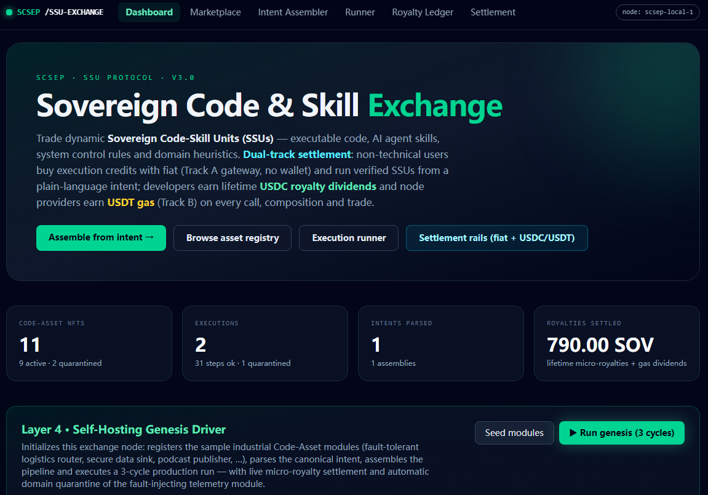
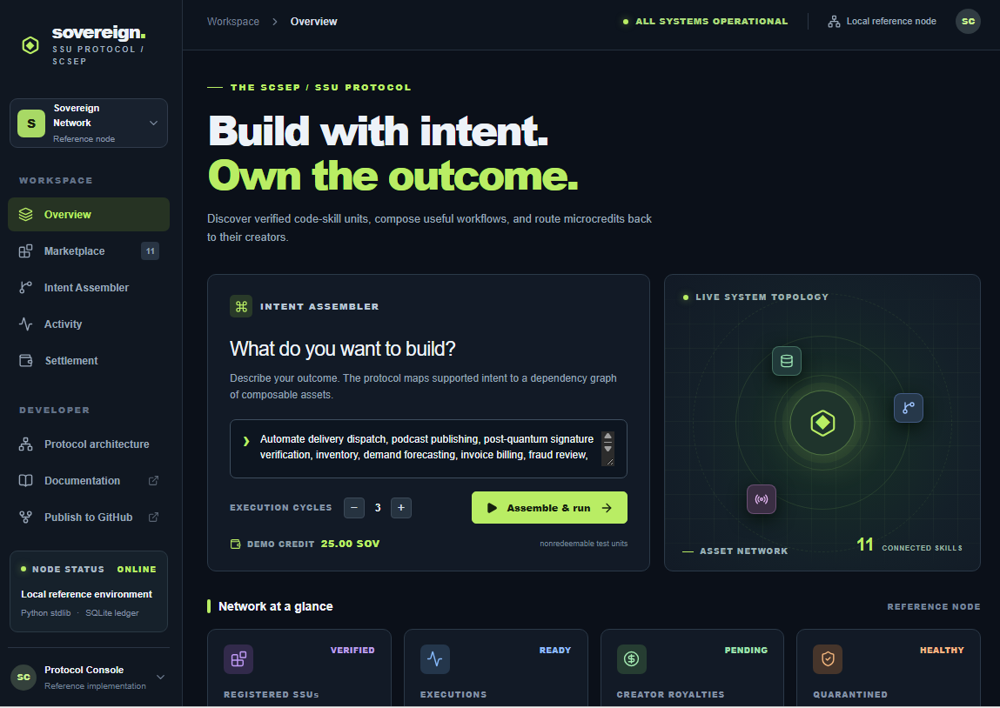

# 🌐 SCSEP: Sovereign Code & Skill Exchange Protocol (v3.0)

> A Global Public Good establishing deterministic Code-Skill Units (SSUs), dual-track micro-royalty clearance, and universal production democratization.

---

## 🌟 Core Vision & Paradigm Shift

The modern computational ecosystem suffers from a fundamental systemic divide:

1. The Developer Dilemma: Global software engineers create foundational digital logic, yet remain trapped in linear labor exchange without perpetual micro-royalties.
2. The Non-Technical Barrier: Millions of non-technical operators and entrepreneurs are excluded from digital automation due to high technical entry thresholds.

The Sovereign Code & Skill Exchange Protocol (SCSEP) bridges this gap by introducing Sovereign Code-Skill Units (SSUs)—deterministic, self-contained computational artifacts that combine executable source logic, AI Agent skills, and domain heuristics into tradable, royalty-generating digital assets.

---

## 🖥️ System Architecture & Visual Console

---

## 🏗️ System Topology & Four-Layer Architecture

Sovereign-Code-Exchange/
├── README.md               # English Open Source Specification
├── README_CN.md            # Chinese Manifesto & Philosophical Grounding
├── LICENSE                 # Apache 2.0 License
├── CONTRIBUTING.md         # Contribution Guidelines
├── SECURITY.md             # Security Reporting Policy
├── docs/                   # 📖 Comprehensive Technical Documentation
│   └── ARCHITECTURE.md     # Deep-dive 4-Layer Specification & Z_q math
├── core/                   # 🐍 Python Asynchronous Meta-Kernel (Zero-Dep)
│   ├── ssu_manifest.py     # SSU schema, SHA-256 digests & Z_q ring commitments
│   ├── ssu_exchange.py     # Intent-to-DAG assembler & limit order matching
│   └── meta_kernel.py      # Async event-bus & automated fault quarantine sandbox
├── genesis_exchange_runner.py # Layer 4 Self-Hosting Genesis Driver
└── src/                    # ⚛️ Next.js 14 / TypeScript Web Application
    ├── app/
    │   ├── assembler/      # Natural language Intent-to-DAG visualizer
    │   ├── marketplace/    # SSU asset trading registry
    │   ├── runner/         # Interactive execution control panel
    │   └── settlement/     # Dual-track clearance console (Fiat HMAC + USDC ERC-20)
    └── lib/                # SQLite ledgers & ring math utilities

---

## 💳 Dual-Track Settlement Protocol (v3.0)

SCSEP decouples user-facing payment rails from back-end ledger clearance through a resilient multi-tier gateway:

* Track A / Fiat Gateway: Designed for non-technical end users. Accepts credit cards, WeChat/Alipay, and bank transfers via an authenticated HMAC-SHA256 signature scheme (no card data stored on node).
* Track B / On-Chain Stablecoin Settlement: Designed for developers and liquidity nodes. Direct 6-decimal USDC/USDT settlement ensuring instant, cross-border, un-freezable royalty distribution per execution cycle.

---

## 🚀 Quickstart

Get your local sovereign node running in under 2 minutes:

1. Install Node.js dependencies & start Web Dashboard:
npm install
npm run dev

2. Run Python Meta-Kernel Genesis Driver (in parallel terminal):
python genesis_exchange_runner.py

> 📖 Documentation: For full API specifications, Z_q ring commitments math, and module contracts, please refer to docs/ARCHITECTURE.md.

---

## 🌐 Community & Ecosystem Roadmap

- [x] v1.0 - Meta-Kernel Foundation: Zero-dependency Python kernel & SSU schema definition.
- [x] v2.0 - Visual Assembler & Clearance: Next.js 14 Web console & HMAC Fiat / USDC dual-track settlement.
- [x] v3.0 - Sovereign Release: Self-hosting genesis drivers & open-source public good protocol.
- [ ] v4.0 - P2P Network Protocol: Direct libp2p node discovery & cross-node SSU orderbook propagation.

---

## 📜 License & Public Good Commitment

This protocol is released as a Global Public Good under the Apache 2.0 License. 

Dedicated to human computational dignity, perpetual developer royalties, and universal access to production automation.